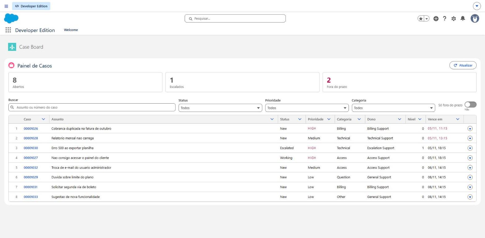
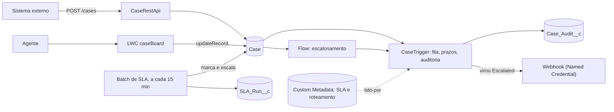

# CaseForce

[](https://github.com/LeopratesDev/caseforce/actions/workflows/ci.yml)


Central de atendimento sobre **Salesforce Service Cloud**: o caso é roteado para a fila certa, ganha prazos de SLA por prioridade, é escalado por um agente ou pelo tempo, deixa uma trilha de auditoria e avisa sistemas externos. Tem um painel em LWC para o agente trabalhar a fila e uma API REST para sistemas externos abrirem casos.



<sub>O painel (aba **Case Board**) com casos de demonstração: 8 abertos, 1 escalado e 2 fora do prazo. Vencidos e prioridades altas ficam em vermelho.</sub>

## Por que este projeto existe

Antes de programar, trabalhei do outro lado do chamado: SAC e suporte técnico. Já construí esse domínio em Node/NestJS no [helpdesk-api](https://github.com/LeopratesDev/helpdesk-api). O CaseForce refaz o problema na plataforma que muitas empresas usam de fato, com as ferramentas dela: Apex, Flow, LWC, Custom Metadata, Named Credentials e metadados versionados.

## Como as peças se encaixam



Um caso criado pela API ou pelo painel passa pelo mesmo caminho: o trigger o põe na fila da categoria e calcula os prazos; escalar (à mão ou pelo Batch) aciona o Flow, que sobe nível e prioridade; tudo fica na auditoria; e o webhook avisa o sistema externo.

## O que foi feito, etapa por etapa

| # | Etapa | Entrega | Detalhes |
|---|---|---|---|
| 1 | Modelo de dados | Campos de Case, `Case_Audit__c`, Custom Metadata de SLA e roteamento, filas, permission sets | [data-model](docs/data-model.md) |
| 2 | Apex Trigger | Roteamento por categoria, prazos de SLA, primeira resposta, auditoria, validação de fechamento | [etapa 2](docs/etapa-2-apex.md) |
| 3 | Flow | Escalonamento: sobe nível e prioridade e manda para a fila de escalonamento | [etapa 3](docs/etapa-3-flow.md) |
| 4 | LWC | Painel de casos: métricas, filtros, edição na célula, ações Escalar e Assumir | [etapa 4](docs/etapa-4-lwc.md) |
| 5 | Integração | API REST de entrada e webhook de saída com Named Credential | [etapa 5](docs/etapa-5-integracao.md) |
| 6 | Batch Apex | Marca SLA estourado, escala e grava o resumo da rodada; agendador pronto | [etapa 6](docs/etapa-6-batch.md) |
| 7 | CI e acabamento | GitHub Actions, verificação de metadados, este README | [etapa 7](docs/etapa-7-ci.md) |

Cada documento de etapa traz as decisões, as limitações e **o que deu errado no caminho**, que é onde mais se aprende.

## Números medidos

| | Resultado |
|---|---|
| Testes Apex | **69**, todos passando na org, em duas execuções seguidas |
| Cobertura Apex | **97%** no total (`CaseSlaBreachBatch` 91%, `CaseRestApi` 94%, o resto de 95% a 100%) |
| Testes Jest (LWC) | **13**. Cobertura de `caseBoard.js`: 92% das instruções, 90% das funções, **60% dos ramos** |
| Verificação de metadados | `scripts/check_metadata.py`: 69 arquivos XML, versão de API e credenciais |

Esses números vieram de execuções reais numa Developer Edition org, não de estimativa. O que **não** está coberto está listado em cada documento de etapa.

## Estrutura

```
force-app/main/default/
  objects/            Case (campos), Case_Audit__c, SLA_Run__c, SLA_Policy__mdt, Category_Routing__mdt
  customMetadata/     valores de SLA e de roteamento
  queues/             filas por categoria e fila de escalonamento
  permissionsets/     CaseForce_Agent, CaseForce_Manager, CaseForce_Integration
  classes/ triggers/  Apex: trigger, serviços, API REST, webhook, Batch e testes
  flows/              escalonamento
  lwc/                painel de casos (caseBoard) e testes Jest
  flexipages/ tabs/ applications/   página, aba e app CaseForce
  namedCredentials/ externalCredentials/   destino do webhook
scripts/              verificação de metadados
config/               definição de scratch org
docs/                 documentação e print
.github/workflows/    CI
```

## Como rodar

Pré-requisitos: Node 22 ou mais novo, Salesforce CLI (`sf`) e uma Developer Edition org (grátis, em developer.salesforce.com/signup).

```bash
npm install
sf org login web --alias caseforce
sf project deploy start --source-dir force-app --target-org caseforce --test-level RunLocalTests
sf org assign permset --name CaseForce_Manager --target-org caseforce
```

Depois abra o app **CaseForce** no Lançador de Aplicativos e vá na aba **Case Board**. Para ter o que ver, crie casos pela API ou pelo próprio Salesforce.

Testes e verificações:

```bash
npm run test:unit                                    # LWC (Jest)
python scripts/check_metadata.py                     # metadados, sem precisar de org
sf apex run test --target-org caseforce --test-level RunLocalTests --code-coverage --synchronous
```

**Dois avisos antes de rodar na sua org:**

- O Named Credential do webhook aponta para `https://httpbin.org`, um serviço público de demonstração. **Troque a URL** pelo destino real antes de usar para valer.
- O agendamento do Batch **não vem ligado**. Para ligar: `CaseSlaBreachScheduler.scheduleEvery15Minutes();` no Execute Anonymous.

## CI

O GitHub Actions roda a cada push na `main` e a cada pull request:

- **Metadados:** XML e JSON válidos, todo `.cls` e `.trigger` com seu `-meta.xml`, versão de API no padrão e nenhuma credencial no código.
- **LWC:** os testes Jest com cobertura.
- **Apex:** valida o deploy e roda todos os testes na org, **mas só se o segredo `SFDX_AUTH_URL` existir**. Sem ele o job termina verde avisando que foi pulado. Como ligar: [docs/etapa-7-ci.md](docs/etapa-7-ci.md).

## Limitações conhecidas

- Prazos de SLA em **minutos corridos**, sem horário comercial nem feriados.
- A coluna **Assunto** do painel encolhe quando a janela fica menor que cerca de 1100 px, porque as outras colunas têm largura fixa.
- No painel, a edição na célula, a ação **Assumir** e a busca por texto estão cobertas pelo Jest, mas **não foram testadas à mão no navegador**.
- A API REST não tem idempotência (o mesmo `POST` duas vezes cria dois casos), e o webhook não repete envios que falham.
- O job de **Apex do CI nunca rodou de verdade**: depende de um segredo que ainda não foi criado. O que está escrito nele é o que a documentação do Salesforce CLI indica, mas está sem prova.
- Interface e mensagens de erro só em português.
- Funciona numa org só: foi implantado e testado em uma Developer Edition. Não foi testado em outra org nem em scratch org.

## Licença

Sem licença definida ainda. Enquanto não houver um arquivo `LICENSE`, o código é público para leitura, mas sem permissão explícita de reuso.
