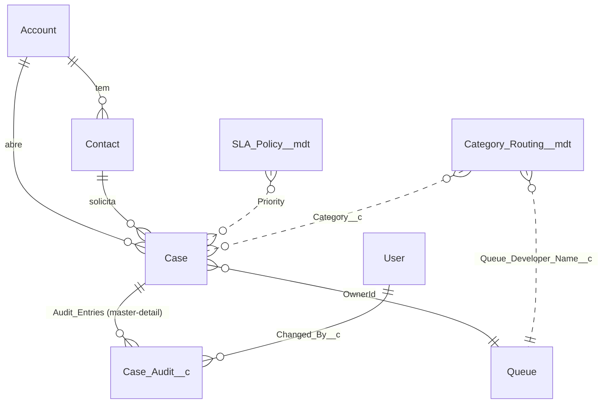

# Modelo de dados

O CaseForce reaproveita o objeto padrão **Case** do Service Cloud e adiciona só o que o padrão não cobre. Regra de projeto: **configuração em Custom Metadata, não em código**, para que SLA e roteamento mudem sem deploy.

Linhas pontilhadas são ligações **por valor** (texto), não por relacionamento: o Apex lê o Custom Metadata e aplica no Case.

## Objetos padrão usados

| Objeto | Uso |
|---|---|
| Account / Contact | Empresa e pessoa que abre o chamado |
| Case | O ticket. Campos padrão usados: `Status`, `Priority`, `Subject`, `Description`, `Origin`, `OwnerId` |
| Group (Queue) | Filas de atendimento |

## Campos customizados em Case

| Campo | Tipo | Quem preenche | Para quê |
|---|---|---|---|
| `Category__c` | Picklist restrita (Billing, Technical, Access, Question, Other) | Agente / criação | Define a fila via `Category_Routing__mdt` |
| `Escalation_Level__c` | Number(2,0), padrão 0 | Flow de escalonamento | Quantas vezes o caso subiu |
| `First_Response_At__c` | DateTime | Trigger (uma vez só) | Mede o tempo de primeira resposta |
| `Response_Due_At__c` | DateTime | Trigger | Prazo da primeira resposta (SLA) |
| `Resolution_Due_At__c` | DateTime | Trigger | Prazo de resolução (SLA); recalculado se a prioridade mudar |
| `SLA_Breached__c` | Checkbox | Batch agendado | Marca casos abertos que passaram do prazo |
| `Resolution_Summary__c` | Long Text | Agente | Obrigatório para fechar (validation rule, etapa 2) |

`Category__c`, `Escalation_Level__c` e `SLA_Breached__c` têm **histórico de campo** ligado.

## Objeto customizado: `Case_Audit__c`

Trilha de auditoria, equivalente ao histórico do [helpdesk-api](https://github.com/LeopratesDev/helpdesk-api). Uma linha por mudança relevante.

| Campo | Tipo | Observação |
|---|---|---|
| Name | Auto Number `AUD-{00000}` | |
| `Case__c` | Master-Detail → Case | Apagar o Case apaga a auditoria; o acesso herda do Case (`ControlledByParent`) |
| `Field_Name__c` | Text(80), obrigatório | Campo alterado |
| `Old_Value__c` / `New_Value__c` | Text(255) | Valor antes e depois |
| `Changed_By__c` | Lookup → User | Quem mudou (`SetNull` se o usuário for removido) |

## Custom Metadata Types

**`SLA_Policy__mdt`** — metas em minutos por prioridade (valores iniciais, ajustáveis):

| Priority | Resposta | Resolução |
|---|---|---|
| High | 30 min | 240 min (4 h) |
| Medium | 120 min (2 h) | 1440 min (24 h) |
| Low | 480 min (8 h) | 4320 min (72 h) |

**`Category_Routing__mdt`** — categoria → fila:

| Category | Fila (DeveloperName) |
|---|---|
| Billing | `Billing_Support` |
| Technical | `Technical_Support` |
| Access | `Access_Support` |
| Question, Other | `General_Support` |

## Segurança

Dois Permission Sets, sem mexer em perfil:

| | Agent | Manager |
|---|---|---|
| Categoria, escalonamento, resumo de resolução | edita | edita |
| Campos de SLA (`*_Due_At__c`, `SLA_Breached__c`, `First_Response_At__c`) | só lê | edita |
| `Case_Audit__c` | lê o que o Case permite | lê tudo (`viewAllRecords`) |

A auditoria nunca é editável por pessoas: só o código (trigger) escreve nela.

## Decisões e por quê

- **Custom Metadata em vez de objeto customizado para SLA e roteamento.** Vai junto no deploy, é testável e pode ser lido pelo Apex sem gastar limite de SOQL.
- **Master-Detail na auditoria.** Garante que nunca exista auditoria órfã e herda a visibilidade do Case.
- **Prazos gravados no Case** (`*_Due_At__c`) em vez de calculados na leitura. Permite filtrar e ordenar a fila por vencimento e consultar o que estourou com um SOQL simples.
- **Filas de casos** (Queue) em vez de campo de texto, para usar o recurso nativo de propriedade e de "Aceitar caso".

## Ainda fora do modelo (próximas etapas)

Validation rule do resumo de resolução (etapa 2), Entitlements/Milestones se eu optar por SLA nativo no lugar do cálculo manual (etapa 3), objeto de configuração para a integração externa (etapa 5).
