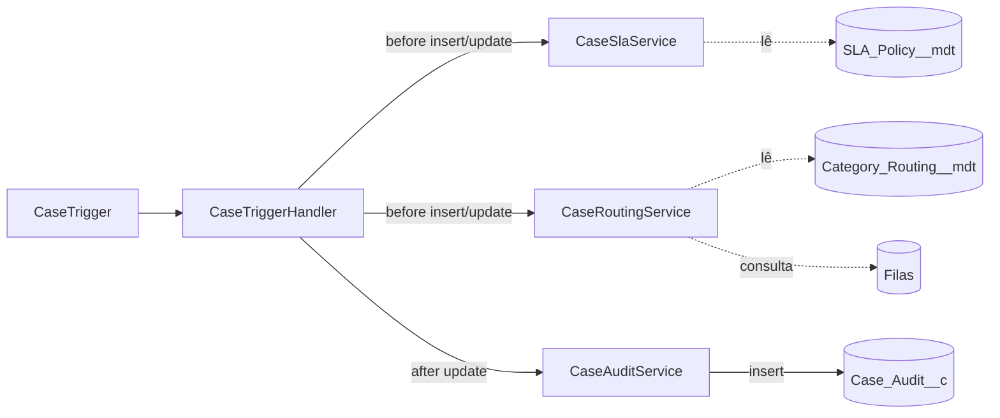

# Etapa 2: Apex Trigger

Um único trigger no Case (`CaseTrigger`) que só delega para o `CaseTriggerHandler`. A regra de negócio fica em três serviços, cada um com uma responsabilidade.

## Regras

| Serviço | Quando roda | O que faz |
|---|---|---|
| `CaseRoutingService` | before insert, e before update se a categoria mudou | Põe o caso na fila da categoria (`Category_Routing__mdt`). Se a categoria não mudou, não mexe no dono. |
| `CaseSlaService.setDueDates` | before insert, e before update se a prioridade mudou | Calcula `Response_Due_At__c` e `Resolution_Due_At__c` a partir de `SLA_Policy__mdt`. Prioridade vazia usa Medium. Depois da primeira resposta, o prazo de resposta não muda mais. Caso fechado é ignorado. |
| `CaseSlaService.markFirstResponse` | before update | Grava `First_Response_At__c` na primeira vez que o caso chega a um status que não é `New` nem `Escalated` (escalar um caso que ninguém tocou não é responder; regra ajustada na etapa 6). Só grava uma vez. |
| `CaseAuditService` | after update | Uma linha em `Case_Audit__c` para cada campo acompanhado que mudou: Status, Priority, OwnerId, Category__c, Escalation_Level__c. |
| Validation rule `Resolution_Summary_Required` | ao salvar | Bloqueia fechar o caso sem `Resolution_Summary__c`. |

A validação ficou **declarativa** de propósito: é uma regra de uma fórmula, e a ferramenta nativa resolve melhor do que código.

## Decisões e por quê

- **Um trigger, um handler, serviços pequenos.** Facilita testar cada regra sozinha e evita a ordem de execução imprevisível de vários triggers no mesmo objeto.
- **Tudo em lote.** Nenhuma consulta ou DML dentro de `for`. O roteamento faz uma consulta de filas por transação, e há um teste que falha se passar de 10 consultas com 200 casos.
- **Configuração em Custom Metadata.** Mudar uma meta de SLA ou a fila de uma categoria não exige deploy de código.
- **Auditoria só no `after update`**, porque ali o dono já foi alterado pelo roteamento. Por isso a troca de fila aparece na auditoria. Como não altera o Case, não há recursão.
- **Nome dos campos resolvido uma vez** (cache estático) em vez de chamar `describe` a cada registro.

## Limitações conhecidas

- Prazos em **minutos corridos**, sem horário comercial nem feriados.
- Na criação, o roteamento **sobrescreve o dono** definido manualmente se houver categoria.
- "Primeira resposta" é uma aproximação: mudança de status (para algo que não seja `New` ou `Escalated`), não e-mail enviado ao cliente.
- `SLA_Breached__c` é preenchido pelo Batch da etapa 6 ([detalhes](etapa-6-batch.md)).

## Testes

19 testes, **98% de cobertura** medida na org (`CaseSlaService` 95%, as demais 100%).

| Classe de teste | Casos |
|---|---|
| `CaseRoutingServiceTest` | roteia na criação, Question e Other na mesma fila, re-roteia ao mudar categoria, não tira o caso de quem assumiu, sem categoria, 200 casos com 5 categorias |
| `CaseSlaServiceTest` | prazos por prioridade, prioridade vazia, recálculo ao mudar prioridade, primeira resposta uma vez só, prazo de resposta fixo depois de responder |
| `CaseAuditServiceTest` | valor antigo e novo, campos não acompanhados, vários campos, troca de dono pelo roteamento, 200 atualizações |
| `CaseClosingValidationTest` | bloqueia sem resumo, permite com resumo, não trava edição de caso já fechado |
