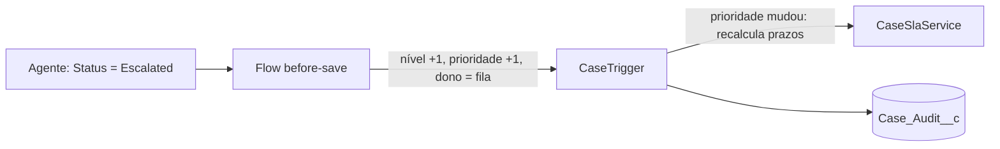

# Etapa 3: Flow de escalonamento

`Case_Escalate_On_Status` é um **record-triggered flow before-save** no Case. Quando um agente move o caso para `Escalated`, ele:

1. sobe `Escalation_Level__c` em 1;
2. sobe a prioridade um degrau (Low → Medium → High; High continua High);
3. entrega o caso à fila **Escalation Support**.

## Por que um Flow, e por que before-save

- É regra de negócio simples e de um objeto só: o tipo de coisa que o Flow resolve sem código.
- **Before-save** altera o próprio registro sem fazer outro `UPDATE`. Menos DML e sem reentrar no trigger.
- A ordem de execução faz tudo se encaixar: o Flow before-save roda **antes** do trigger. Assim o `CaseSlaService` já vê a prioridade nova e **recalcula os prazos**, e o `CaseAuditService` registra Status, Priority, OwnerId e Escalation_Level__c.

## Decisões e por quê

- **Só dispara na mudança para `Escalated`** (`doesRequireRecordChangedToMeetCriteria`). Editar um caso que já está escalado não escalona de novo. Voltar a `Working` e escalar outra vez escalona de novo, de propósito.
- **Se a fila não existir, o dono não é alterado.** Uma decisão protege contra gravar `OwnerId` vazio, que quebraria a atualização.
- **SLA fica no Apex, sem Entitlements.** Entitlements/Milestones exigem configuração por conta e contrato e escondem a lógica em telas. O cálculo atual é testado e versionado. Troco só se o requisito pedir.
- **Escalonamento por tempo fica para o Batch (etapa 6).** Um Flow agendado só dispara com o relógio, então é difícil de testar. Em Apex dá para testar e dispara a partir de `SLA_Breached__c`.

## Limitações conhecidas

- Não envia e-mail nem notificação ao gestor da fila. Depende de template e de membros reais na fila.
- A fila `Escalation_Support` nasce sem membros. Ela existe, mas alguém precisa ser adicionado a ela na org.
- Em produção, ativar um Flow por deploy exige cobertura de teste do Flow. Em Developer Edition isso não é cobrado.

## Testes

7 testes em `CaseEscalationFlowTest` (26 no projeto, 98% de cobertura de Apex), todos passando na org. A cobertura de Apex não mede o Flow, então os testes confirmam o comportamento disparando o Flow por DML:

| Caso testado | Resultado esperado |
|---|---|
| Low → Escalated | nível 1, prioridade Medium, dono = fila |
| High → Escalated | prioridade continua High, nível 1 |
| Escalar duas vezes | nível 2, prioridade High |
| Editar caso já escalado | não escalona de novo |
| Mudar para Working | não escalona |
| Escalar | prazo de resolução encurta e a auditoria registra os 4 campos |
| 200 casos de uma vez | todos escalonados (lote) |

## Armadilha que apareceu no desenvolvimento

Num teste, reaproveitei o objeto `Case` em memória para um segundo `update`. Ele reenviou a prioridade antiga e **desfez** o que o Flow tinha gravado. Em teste de Flow, atualize só os campos que mudam (`update new Case(Id = c.Id, Status = '...')`) ou consulte o registro de novo.

## Para explicar em entrevista

> Usei Flow onde a regra era declarativa e Apex onde precisei de lógica. O escalonamento é um flow before-save, então altera o registro sem DML extra. Entendi a ordem de execução: o flow roda antes do trigger, por isso os prazos de SLA são recalculados com a prioridade nova e a auditoria já enxerga a mudança. Deixei o escalonamento por tempo para um Batch porque é testável, e Flow agendado não é.
