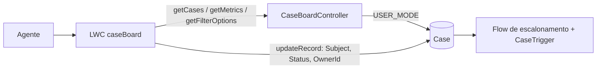

# Etapa 4: LWC, o painel de casos

O app **CaseForce** ganha a aba **Case Board**: um painel único para o agente enxergar a fila, filtrar, corrigir um assunto na própria tabela e escalar ou assumir um caso com um clique.

## O que o painel mostra e faz

| Recurso | Como funciona |
|---|---|
| Métricas | Abertos, escalados e fora do prazo, contados no Apex |
| Filtros | Status, prioridade, categoria, busca por assunto ou número, e "só fora do prazo". As opções vêm das picklists reais do Case |
| Busca | Espera 300 ms depois da última tecla antes de consultar |
| Tabela | Ordenada pelo prazo de resolução mais próximo; fora do prazo e prioridade alta aparecem em vermelho; o número do caso abre o registro |
| Edição na célula | O assunto é editável direto na tabela; salvar faz um `updateRecord` por linha |
| Ações da linha | **Escalar** muda o status para `Escalated` (o Flow da etapa 3 faz o resto) e **Assumir** passa o dono para o usuário logado |

## Decisões e por quê

- **`updateRecord` do LDS para gravar, Apex só para ler.** As edições passam pelo mesmo caminho do Lightning: validation rule, Flow, trigger e permissões continuam valendo, e não há segunda via de escrita para manter.
- **`USER_MODE` em toda consulta.** O painel só mostra o que o usuário pode ver. Há teste rodando como um usuário com o permission set de agente.
- **Texto digitado entra só como variável de bind** (`Database.queryWithBinds`), nunca concatenado na consulta. `%` e `_` digitados são tratados como texto. Há teste com aspas e `%`.
- **Limite de 200 linhas** na consulta, e a tela não promete paginação. É um painel de trabalho, não um relatório.
- **Aplicação das regras antigas de graça:** como "Escalar" passa por `updateRecord`, o caso ganha nível, prioridade maior, nova fila, prazos recalculados e auditoria sem uma linha de código a mais no componente.
- **Leitura imperativa, não `@wire`.** O resultado muda a cada filtro e a cada ação, e `getCases` não é `cacheable` justamente para nunca mostrar dado velho depois de uma edição.

## Testes e verificação

| Camada | Resultado |
|---|---|
| Apex (`CaseBoardControllerTest`) | 10 testes novos; **36 testes no projeto, todos passando na org** |
| LWC (Jest) | 13 testes passando. Cobertura de `caseBoard.js`: **92% das instruções, 90% das funções, 60% dos ramos** (os ramos são o ponto fraco) |
| Navegador, na org, com 8 casos de demonstração | Métricas corretas (8 abertos, 1 escalado, 2 fora do prazo); ordem por prazo; vermelho nos vencidos e nas prioridades altas; **Escalar** no caso `00001029` (Low → Escalated, prioridade Medium, nível 1, fila Escalation Support, prazo recalculado, métrica de escalados de 1 para 2); filtro de prioridade (3 casos High); filtros de prioridade e "só fora do prazo" juntos (1 caso) |

**Confirmado depois, no navegador e no banco:** a busca por texto ("boleto" devolveu os dois casos certos), o botão **Assumir** (o dono do `00001031` passou de Billing Support para o usuário logado, e a auditoria registrou a troca) e a edição do assunto na célula (barra Cancelar/Salvar, aviso "Salvo" e o novo assunto gravado). Na primeira tentativa a automação não conseguiu digitar no campo da tabela; o que funcionou foi definir o valor do campo e confirmar.

## O que deu errado no caminho (e o que ficou)

1. **O filtro não filtrava, e os testes passavam.** O filtro ia como um objeto Apex (`BoardFilters`). No navegador o servidor devolvia todos os casos, mesmo com `priority: "High"` na requisição, porque o objeto chegava sem os campos. Nos testes Apex, que chamam o método direto, isso não aparece. Troquei por parâmetros simples (texto e booleano). Achei isso olhando a requisição e a resposta de verdade, não adivinhando.
2. **O navegador serviu o componente antigo depois do deploy.** Meu primeiro teste da correção não provou nada: a requisição ainda saía no formato antigo. A org já tinha o código novo, e o Chrome tinha o antigo em cache. Só um recarregamento forçado (`Ctrl+Shift+R`) mostrou o resultado certo. Depois de implantar um LWC, recarregue sem cache antes de concluir qualquer coisa.
3. **O permission set não bastava.** Um usuário só com `CaseForce_Agent` não conseguia ler `Case.Subject`, porque eu liberava só os campos customizados. O teste com usuário não administrador pegou isso. Agora os dois permission sets liberam também Subject, Status, Priority, Origin e Description, e dão acesso ao app, à aba e ao controller.

## Limitações conhecidas

- Sem paginação nem ordenação por coluna (teto de 200 linhas).
- Só o assunto é editável na célula. Status e prioridade mudam pelas ações da linha, porque o datatable nativo não edita picklist.
- Interface só em português.
- O filtro de busca trata `%` e `_` como texto, então não há curingas.
- Não atualiza sozinho quando outra pessoa mexe nos casos: use o botão **Atualizar**.

## Para explicar em entrevista

> Fiz o painel em LWC com um controller Apex só de leitura e gravação pelo `updateRecord`, para a tela passar pelas mesmas regras do resto do sistema: validation rule, Flow, trigger e permissões. As consultas rodam em `USER_MODE` e o texto digitado entra só como bind. Um bug me ensinou bastante: o filtro não funcionava na tela, mas os testes passavam, porque o objeto de filtros chegava vazio pelo Aura. Descobri comparando a requisição e a resposta no navegador e troquei por parâmetros simples. Também aprendi a recarregar sem cache depois de implantar um LWC, e a testar com um usuário que só tem o permission set, porque foi assim que achei campos sem permissão.
