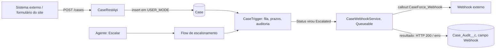

# Etapa 5: integração

Duas pontas, uma para cada direção:

- **Entrada:** uma API REST em Apex (`CaseRestApi`) para sistemas externos abrirem e consultarem casos.
- **Saída:** um webhook (`CaseWebhookService`) que avisa um sistema externo quando um caso é escalado, usando um **Named Credential**.



## API de entrada

| Método e caminho | O que faz | Respostas |
|---|---|---|
| `POST /services/apexrest/caseforce/v1/cases` | Cria um caso | `201` com o caso; `400` com a lista de problemas; `403` sem permissão |
| `GET /services/apexrest/caseforce/v1/cases/{numero}` | Consulta por número do caso | `200`; `404` se não existir; `400` sem número |

Corpo do `POST` (só `subject` é obrigatório):

```json
{
  "subject": "Fatura não chegou",
  "description": "Cliente não recebeu a fatura de outubro",
  "category": "Billing",
  "priority": "High",
  "contactEmail": "cliente@example.com"
}
```

Resposta (o trigger e o Flow já rodaram, então o caso volta roteado e com prazos):

```json
{
  "id": "500fj00002lBIDdAAO",
  "caseNumber": "00001035",
  "status": "New",
  "priority": "Low",
  "category": "Billing",
  "queue": "Billing Support",
  "escalationLevel": 0,
  "responseDueAt": "2026-11-06T01:35:39.000Z",
  "resolutionDueAt": "2026-11-08T17:35:39.000Z"
}
```

Chamada de exemplo (o token vem do fluxo OAuth da org; **nunca** o coloque no repositório):

```bash
curl -X POST "https://SUA-ORG.my.salesforce.com/services/apexrest/caseforce/v1/cases" \
  -H "Authorization: Bearer $SF_ACCESS_TOKEN" -H "Content-Type: application/json" \
  -d '{"subject":"Fatura não chegou","category":"Billing","priority":"High"}'
```

Pelo Salesforce CLI, sem lidar com token: `sf api request rest "/services/apexrest/caseforce/v1/cases" --method POST --body '{...}' --target-org caseforce`. No **Git Bash do Windows**, prefixe com `MSYS_NO_PATHCONV=1`, senão o shell reescreve o caminho que começa com `/` e a org responde `404`.

### Decisões e por quê

- **`USER_MODE` no insert e nas consultas.** A API faz só o que o usuário que chama pode. Para chamadas externas existe o permission set **`CaseForce_Integration`**: cria e lê casos, não edita nem apaga, não vê a auditoria nem o painel, e não altera status nem prazos.
- **Validação com mensagem útil.** Categoria ou prioridade inválida devolve a lista dos valores aceitos, lida da picklist real (se alguém adicionar um valor, a API passa a aceitar sozinha).
- **Corpo lido e validado à mão** (`JSON.deserialize` dentro de `try/catch`), para JSON quebrado ou vazio virar `400`, nunca `500`.
- **E-mail sem contato correspondente não bloqueia.** O caso é criado sem contato; perder um chamado seria pior do que criá-lo sem vínculo.
- **A resposta é lida de volta do banco**, porque quem calcula fila e prazos é o trigger.

## Webhook de saída

Quando o status de um caso **passa a** `Escalated`, um job `Queueable` envia um `POST` para `callout:CaseForce_Webhook/post`. URL e autenticação ficam no Named Credential e no External Credential, fora do código.

- **Sem texto livre.** O payload leva só `event`, `caseNumber`, `priority`, `category`, `escalationLevel`, `queue` e `resolutionDueAt`. Assunto e descrição, que podem ter dado pessoal do cliente, **não saem da org**. Há teste que confere isso.
- **Resultado na auditoria.** Cada envio vira uma linha em `Case_Audit__c` com o campo `Webhook` (`HTTP 200`, `HTTP 500` ou `Erro: ...`), então falha de integração aparece junto ao histórico do caso.
- **Falha do webhook não derruba a escalação.** O caso escala mesmo se o destino estiver fora do ar.
- **Em lotes.** Os casos são divididos em jobs de até 100 (limite de chamadas HTTP por transação), e o DML da auditoria vem só depois de todas as chamadas, como o Salesforce exige. Há teste com 120 casos.
- **Só na transição.** Editar um caso já escalado não chama o webhook de novo.

### Destino de demonstração

O Named Credential aponta para `https://httpbin.org`, um serviço público que apenas ecoa o que recebe. Foi escolhido para eu poder provar a chamada de verdade sem montar um servidor. **Em uso real, troque a URL do Named Credential** pelo destino verdadeiro (Slack, ITSM etc.) e preencha a credencial.

## Testes e verificação

| Camada | Resultado |
|---|---|
| Apex | 56 testes na org, **todos passando em duas execuções seguidas**. 20 novos: 12 de `CaseRestApiTest` e 8 de `CaseWebhookServiceTest`. Cobertura total **97%**: `CaseWebhookService` 100%, `CaseRestApi` 94% |
| API REST, na org, com chamadas reais | `POST` válido → `201` com fila `Billing Support` e prazos; `GET` por número → `200`; sem `subject` → `400`; categoria inválida → `400` com a lista; JSON quebrado → `400`; caso inexistente → `404` |
| Webhook, na org, com chamada real | Ao escalar o caso `00001035`, a auditoria registrou `Status`, `Priority`, `OwnerId`, `Escalation_Level__c` e **`Webhook → HTTP 200`** |

**Não coberto:** o ramo de `403` da API (usuário sem permissão), linhas 52 a 56 da `CaseRestApi`. Não consegui montar um teste confiável: o resultado depende de qual perfil padrão a org oferece, então o teste poderia passar ou falhar por motivo errado. O que há de prova é o teste positivo do usuário de integração, que só consegue o que o permission set dá.

## O que deu errado no caminho

1. **`NoAuthentication` não existe em External Credential.** O Salesforce recusou o deploy. Usei o protocolo `Custom`, que também é o modo correto para um webhook que exija chave, guardada na credencial e nunca no código.
2. **`Owner.Name` vem nulo para filas em teste.** Em contexto de teste, o dono era mesmo a fila, mas `Owner.Name` voltava `null`; na org real (e na chamada REST) vem certo. Descobri com uma classe de sondagem descartável e passei a conferir o dono pelo Id nos testes. O campo `queue` ficou provado só pela chamada real.
3. **`MIXED_DML_OPERATION` num teste que já existia.** Ao mover o helper de criar usuário para a fábrica de testes, um teste do painel passou a falhar de forma determinística. Corrigi isolando a criação do usuário num `System.runAs`. Não sei explicar por que ele passava antes da mudança.
4. **`404` que não era da minha API.** O Git Bash do Windows reescrevia o caminho `/services/...` como caminho de arquivo; até a chamada de sanidade falhava. O `MSYS_NO_PATHCONV=1` resolveu.

## Limitações conhecidas

- **Sem idempotência.** Enviar o mesmo `POST` duas vezes cria dois casos.
- **Sem repetição do webhook** quando falha; fica só o registro na auditoria.
- **Sem assinatura HMAC** do payload e sem limite de taxa na API (vale o limite padrão da plataforma).
- **A credencial `Custom` está sem segredo.** Para um destino real que exija chave, é preciso preencher o parâmetro de autenticação na org.
- O webhook e a API só têm texto em português nas mensagens de erro.
- O interruptor `enabledInTests` desliga o webhook nos testes do restante do projeto, que escalam casos o tempo todo e não devem chamar a rede. É um atalho de teste, e ele é `@TestVisible`.
