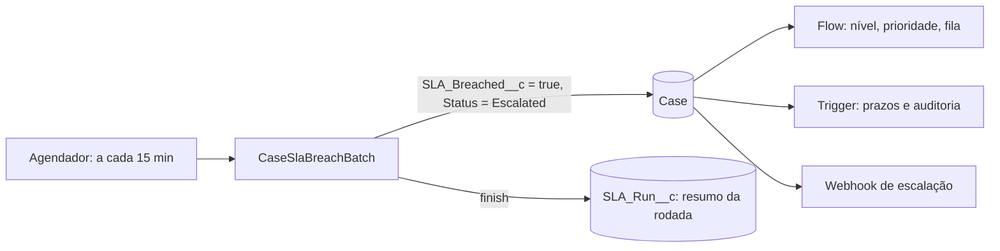

# Etapa 6: Batch Apex de SLA

Um job agendado que varre os casos abertos, marca os que **estouraram o SLA** e escala os que ainda não estavam escalados. Ao final, grava um resumo da rodada.



## Quem estoura o SLA

Um caso entra na rodada se está **aberto**, **ainda não foi marcado** e:

- passou do prazo de resolução (`Resolution_Due_At__c`), **ou**
- passou do prazo de resposta (`Response_Due_At__c`) **sem ninguém ter respondido** (`First_Response_At__c` vazio).

Para cada um, o Batch marca `SLA_Breached__c` e, se o caso ainda não estiver `Escalated`, muda o status para `Escalated`. Daí em diante vale tudo que as etapas anteriores já fazem: o Flow sobe nível e prioridade e manda para a fila de escalonamento, o trigger recalcula prazos e audita (inclusive a própria marca de SLA), e o webhook avisa o sistema externo.

## Resumo da rodada: `SLA_Run__c`

Uma linha por rodada com `Cases_Flagged__c`, `Cases_Escalated__c`, `Failures__c` e `Error_Sample__c` (a primeira mensagem de erro). Rodada que não encontra nada **não grava registro**: a cada 15 minutos seriam 96 linhas vazias por dia. O `CaseForce_Manager` lê esse objeto.

## Agendar

O agendador do Salesforce não aceita "a cada 15 minutos" numa única expressão; são 4 jobs, um por quarto de hora. No Execute Anonymous:

```apex
CaseSlaBreachScheduler.scheduleEvery15Minutes();   // liga; chamar de novo não duplica
CaseSlaBreachScheduler.abortScheduled();           // desliga
```

**Eu não agendei na sua org.** Rodei o Batch uma vez, à mão, para verificar. Ligar o agendamento é uma decisão sua: a partir daí o job passa a escalar casos sozinho e a chamar o webhook.

## Decisões e por quê

- **Lote de 100, e não os 200 padrão.** Dentro de um `execute` só dá para enfileirar **1** job assíncrono, e o webhook cria 1 job por bloco de 100 casos. Um lote maior estouraria o limite. A constante está ligada a `CaseWebhookService.CHUNK_SIZE`, e há teste com um lote cheio.
- **Primeira resposta ganhou uma regra nova.** Antes, "primeira resposta" era o caso sair de `New`. Escalar pelo Batch tiraria um caso **sem resposta** de `New` e o registraria como respondido, o que é falso. Agora a primeira resposta é chegar a um status que não seja `New` nem `Escalated`. Isso muda a etapa 2 e tem teste próprio.
- **Escalar só quem ainda não estava escalado.** O Flow só dispara quando o status *muda*; reaplicar `Escalated` não faria nada, e o nível não pode subir de novo só porque a rodada passou por ali.
- **`SLA_Breached__c` entrou na auditoria**, então o histórico do caso explica *por que* ele foi escalado: `SLA_Breached__c: false → true`.
- **Atualização parcial** (`Database.update(..., false)`): um caso com problema não derruba os outros 99, e a falha vai para o resumo.

## Testes e verificação

| Camada | Resultado |
|---|---|
| Apex | **69 testes na org, todos passando em duas execuções seguidas.** 13 novos: 12 em `CaseSlaBreachBatchTest` e 1 em `CaseSlaServiceTest`. Cobertura total **97%**: `CaseSlaBreachScheduler` 100%, `CaseSlaBreachBatch` 91% |
| Batch, na org, com dados reais | Marcou 3 casos: `00001026` e `00001028` por prazo de resolução vencido, e `00001034` por prazo de resposta vencido sem resposta. Escalou os 3, gravou `RUN-0000` (3 marcados, 3 escalados, 0 falhas) e o webhook devolveu `HTTP 200`. Os casos já escalados e dentro do prazo ficaram intactos |

**Não coberto:** o ramo de falha de atualização do Batch (linhas 57 a 59 de `CaseSlaBreachBatch`). Não achei um jeito confiável de forçar uma falha de `update` no caso de teste.

## O que deu errado no caminho

1. **Escalar encurta o prazo, e isso enganou meu teste.** Dois testes de "já escalado" falhavam porque escalar sobe a prioridade e o trigger recalcula o prazo *a partir da criação*: num caso recém-criado, o novo prazo cai no futuro e apaga o atraso que eu tinha forçado. Num caso real, vencido há horas, o prazo menor continuaria vencido. Ajustei o teste para fixar o atraso depois de escalar.
2. **O Batch achou um caso que eu não esperava** (`00001034`). Era um caso `High` criado pela API na etapa anterior, sem resposta há mais de 30 minutos. É o comportamento correto, mas mostra que **o Batch só ficou testado na org porque os dados de demonstração estavam lá**.

## Limitações conhecidas

- Prazos em minutos corridos, sem horário comercial nem feriados.
- Granularidade de 15 minutos: um caso pode passar até 15 minutos do prazo antes de ser marcado.
- Sem alerta ao gestor quando uma rodada tem falhas; só o registro em `SLA_Run__c`.
- O Batch roda com as permissões de quem o agendou, e as alterações constam na auditoria como feitas por essa pessoa.

## Para explicar em entrevista

> Fiz um Batch Apex agendado que marca e escala casos com SLA estourado e grava um resumo da rodada. Dois detalhes de plataforma pesaram: o limite de um job assíncrono por `execute`, que me fez travar o lote em 100 para casar com o webhook, e o fato de que escalar mudava a regra de primeira resposta, que eu corrigi com teste. Testei na org com dados reais e ele pegou um caso que eu não previa. Deixei o agendamento desligado de propósito, porque ligar um job recorrente é uma decisão do dono da org.
